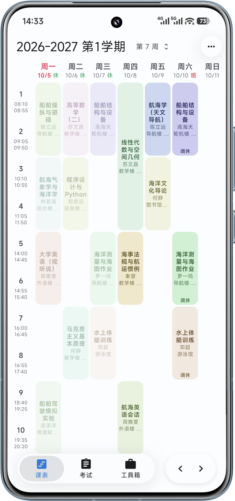
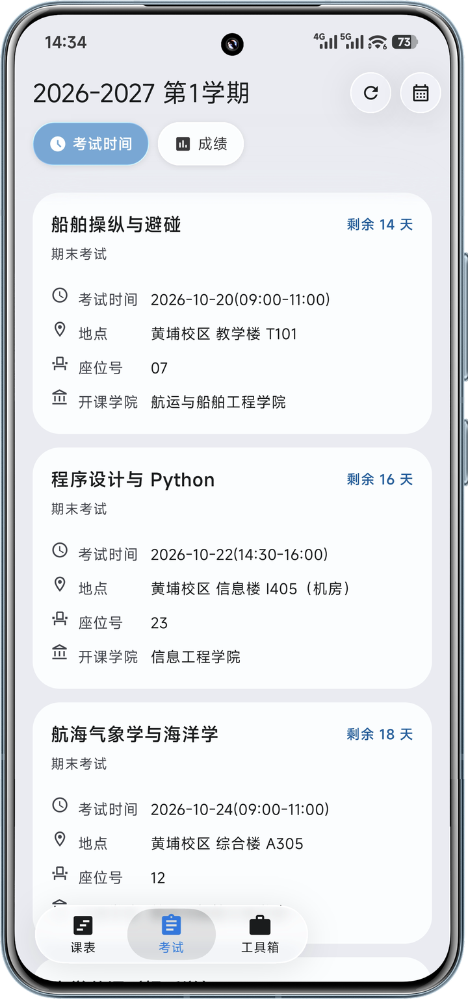
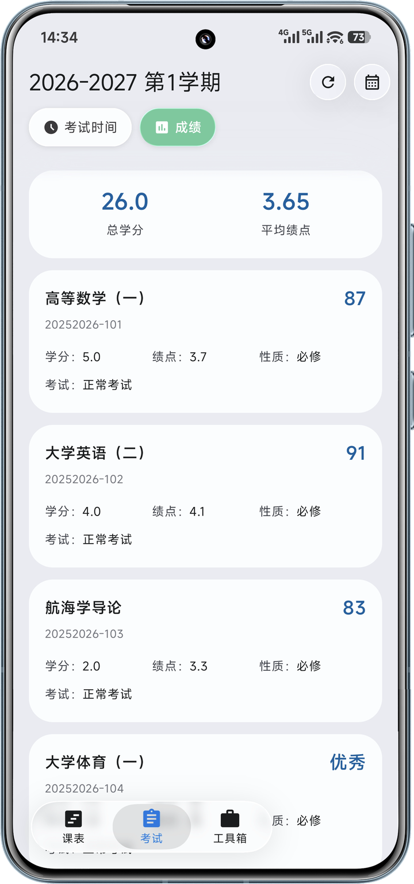
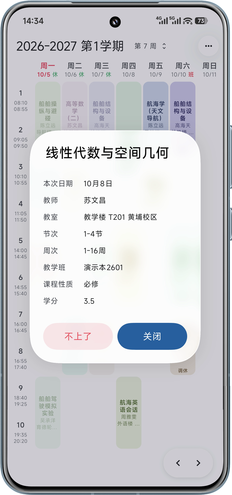

# GZMTU View

[](https://github.com/HZzzHe/GzmtuView/actions/workflows/android.yml)

原生 Android（Kotlin + Jetpack Compose）高校课表客户端，对接正方教务系统 9.0（`jwglxt`）。
提供课表、考试、成绩、体测、电费估算与桌面小部件，界面采用统一的液态玻璃设计。

<table>
  <tr>
    <td width="25%"></td>
    <td width="25%"></td>
    <td width="25%"></td>
    <td width="25%"></td>
  </tr>
  <tr>
    <td align="center">课表周视图<br>节假日调休重排：放假日置灰，补班日按被调走日期排课</td>
    <td align="center">考试<br>倒计时、场次、地点与座位号</td>
    <td align="center">成绩<br>总学分与学分加权平均绩点</td>
    <td align="center">课程详情<br>背板折射的磨砂玻璃对话框</td>
  </tr>
</table>

> 截图中的课程、教师、学号与分数均为编造的演示数据，不包含真实学籍信息。
> 界面为浅色模式，深色模式跟随系统，配色由同一 seed 色推导。

> **免责声明**：本项目为个人开发项目，与任何学校官方无关，仅限学习与研究用途。
> 使用时请遵守所在学校教务系统的使用规定，不得用于高频抓取或自动化选退课。

## 适用范围与已知限制

使用前请确认以下限制。

- **仅验证正方 9.0（`jwglxt`）**。登录流程为 csrftoken → RSA 公钥 → PKCS#1 v1.5 加密 → 提交 →
  索引页确认会话。更换为强智、青果、大雅、URP 或学校自研系统，或使用正方其它大版本时，
  需要修改 `ZFClient` 的请求路径与表单字段。数据接口返回 JSON，字段名固定为 `kcmc`、`xm`、
  `cdmc`、`zcd` 等；学期列表、开学日期与登录页表单从 HTML 中通过正则表达式提取，依赖
  `<input>` 与 `<select>` 的 id 和 value。上述任一处改版均需调整代码。
- **课表网格不处理同一时段的并发课程**。课程卡按整列铺满，宽度为列宽减 3dp，
  两门课程处于同一节次时会相互覆盖。正方课表通常不会产生并发课程；如需支持该场景，
  需修改 `ScheduleGrid` 的分栏逻辑。
- **项目未包含单元测试**。`app/src` 下没有 test 与 androidTest 目录，协议解析的回归验证依赖真机。
  CI（`.github/workflows/android.yml`）仅校验 Gradle wrapper 并执行一次 `assembleRelease`。
  修改 `ZFClient` 的解析逻辑前，请先保留所在学校的脱敏返回样本。
- **仅构建 `arm64-v8a`，`minSdk 26`（Android 8.0）**。如需支持 x86 模拟器或更低系统版本，
  请修改 `app/build.gradle.kts` 的 `abiFilters`。
- **仅支持单设备存储**。课表、考试与成绩保存在本机 JSON 缓存中，不提供云同步、多账号与 ICS 导出。
- **PC 课表接口不可用时会自动改用手机版逐周接口**。备用通道按周请求后合并，
  单学期约 20 次请求、8–9 秒；接口整体不稳定时「完整收录」会明显变慢，
  且学期菜单可能需要一次完整收录才能补齐历史学期。
- 桌面小部件每小时刷新一次，不随课程表实时变化；调休开关修改后需重启 App 生效。

## 克隆后必须修改的配置

1. **教务系统地址** — `app/src/main/java/com/gzmtuview/data/net/ZFClient.kt`

   ```kotlin
   const val DEFAULT_BASE_URL = "https://your-academic-affairs-server.example.edu.cn"
   ```

   请替换为所在学校的教务系统地址，仅填写协议与域名，`/jwglxt` 前缀由代码拼接。
   保持占位值时，所有教务请求会直接抛出「教务系统地址尚未配置」，不会连接 example 域名，
   也不会等待连接超时。

   > 仅验证正方 9.0（`jwglxt`）接口。其它版本或厂商的教务系统需要自行调整
   > `ZFClient` 的请求路径与解析逻辑。

2. **署名与检查更新** — `app/src/main/java/com/gzmtuview/data/net/ProjectRepo.kt`

   ```kotlin
   const val SLUG = ""   // 形如 "your-name/gzmtu-view"
   ```

   留空表示尚未配置公开仓库。此时设置页不显示「项目主页」，检查更新直接返回无信息，
   且不会请求 GitHub API。填入自己的 `<owner>/<repo>` 后可启用检查更新与应用内下载安装；
   Release 需上传 APK 附件，下载完成后会调起系统安装器。

   > 本项目版权署名为 `HZzzHe`，见 `LICENSE` 末尾与 `NOTICE` 第 2 行。
   > 基于本项目制作发行版时，请替换这两处版权行，并按 Apache-2.0 要求保留
   > `LICENSE` 与 `NOTICE` 全文。

   > 包名与命名空间已中性化为 `com.gzmtuview`，涉及 `app/build.gradle.kts` 两处、
   > `app/src/main/java/com/gzmtuview/` 目录与全仓 `import` 字符串。
   > 可直接用于发布；如需更换反域名，请同步修改这三处，否则编译失败。

## 功能

- **登录与会话**：品牌横幅字标在浅色与深色模式间自动切换，支持 RSA 加密登录与持久化 Cookie
  会话恢复，账号密码保存在系统 Keystore 加密存储中。本机存在课表缓存时直接进入主界面并展示
  缓存数据；仅在新安装或清除数据后需要联网确认会话，启动等待过程会显示提示文字。
- **每日同步芯片**：位于课表页右下角，与周次步进器同位同尺寸。当天首次打开时显示航海蓝
  「同步中」状态，课表、考试时间与成绩在同一次作业中获取，完成后芯片退场、步进器恢复。
  数据变化时以玻璃对话框列出变化项目。同一天再次打开不会重复同步，仅补充缺失的数据；
  仅补充考试或成绩时不显示芯片。同步失败时显示警示红「同步失败」，点击打开说明对话框，
  可「再试一次」或「关闭」；会话失效时显示「重新登录」，点击返回登录页并预填学号。
  同一状态仅通过芯片提示，不显示顶部离线横幅，也不使用 WorkManager、闹钟或前台服务，
  同步仅由用户当天主动打开 App 触发。
- **课表**：周视图 Canvas 网格，30 色课程分配，支持全部课程视图、横竖屏自适应与学期切换。
  打开后自动定位当天所在周。周次步进器支持点按切周与长按跳周，窄屏与底栏重叠时自动缩小，
  空间不足时移至底栏上方。缓存当天有效，手动刷新需确认，离线时直接展示缓存。
  支持导出 WakeUp 兼容 CSV 与节假日调休（Beta，默认关闭，需重启，离线内置国务院放假与补班表）。
  课程颜色在本机持久化，冷启动首屏不会短暂显示哈希兜底色。仅收录第 1/2 学期，
  教务预留的第 3 学期（短学期）不进入课表、考试与成绩。PC 课表接口超时或失联时，
  自动改用手机版逐周接口并按课程合并，本次进程内后续学期直接走备用通道。
- **搜索**：课表菜单与工具箱均可进入，支持跨全部已收录学期检索课程、教师、教室、
  考试科目与考场，并可按类型筛选。命中科目已有成绩时显示分数、绩点与学分；
  底部「完整收录」可联网补齐全部学期，收录完成后学期菜单立即刷新，无需重启。
  备用通道只能获取当前学期时会提示可完整收录，每日同步会合并本机已有课表的学期。
- **考试与成绩**：双 Tab、倒计时、小窗玻璃菜单学期切换与跨天旧缓存后台刷新。
  冷启动优先读取磁盘缓存并立即展示，同步完成后覆盖。当天数据由每日同步一并获取，
  进入考试页不再单独发起请求。考试数据源适配正方 PC 端查询接口。
- **工具箱**：体测成绩计算（国标 120 档评分器，年级选择使用小窗玻璃菜单）与
  电费估算（Open-Meteo 温度、宿舍模型与双轴图表）。
- **桌面小部件**：今日课程，动态进度，最多 2 门，每小时刷新，深浅色跟随系统，跟随节假日调休。
  数据在课表落地时推送，包括冷启动预热、缓存秒开、手动刷新与每日同步；每次打开 App
  还会从缓存重推一次，当天新增的小部件无需等待次日刷新。
- **体验**：自定义壁纸（Beta）支持背板层、全局或仅课表显示、压暗与模糊强度，
  玻璃底栏与顶栏会折射壁纸，底栏与周次步进器根据壁纸下缘亮度自动切换深浅样式。
  功能页使用与工具箱子页相同的渐隐磨砂页头，包含 9 项体验开关：课程定位辅助线、课程胶囊、
  学生姓名、任课老师姓名、考试倒计时、周次步进器、交互触感、自动检查更新与优先使用 https 通道。
  课程胶囊关闭后仅隐藏课程卡顶部装饰条，文字位置与排版不变。检查更新使用应用内下载安装，
  未配置 `ProjectRepo.SLUG` 时自动检查会静默跳过。
- **彩蛋**：在设置页「关于」中连续点击 GZMTU View 版本行 5 次，可开启开屏摇一摇广告；
  再次连续点击 5 次关闭。广告仅在进程启动时展示一次，5 秒内摇一摇可直达设置页。
- **体积**：经 R8 裁剪、资源收缩与语言过滤后，release APK 约 1.8 MB。

## 构建

环境要求：JDK 17 及以上、Android SDK 37（`compileSdk 37`、`minSdk 26`、`targetSdk 36`）、
Gradle 9.7.1、Kotlin 2.4.10、Compose BOM 2026.08.00。

```bash
# SDK 位置二选一：local.properties 中写入 sdk.dir，或导出 ANDROID_HOME
./gradlew assembleDebug      # 调试包
./gradlew assembleRelease    # R8 混淆 + 资源收缩
```

未配置 keystore 时，release 构建使用 debug 签名，可直接生成可安装 APK。如需正式签名，
请提供 `release/keystore/gmuview-release.jks`，并在用户级 `gradle.properties` 中配置
`GMUVIEW_RELEASE_STORE_PASSWORD`、`GMUVIEW_RELEASE_KEY_ALIAS`（默认 `gmuview`）与
`GMUVIEW_RELEASE_KEY_PASSWORD`；配置完整时 release 自动切换为正式签名。
密钥与密码不进入仓库，`local.properties` 与 `release/` 已列入 `.gitignore`。

ABI 仅保留 `arm64-v8a`。如需其它架构，请在 `app/build.gradle.kts` 的
`ndk { abiFilters ... }` 中添加。

CI 执行同一 `assembleRelease` 流程：先校验 Gradle wrapper 的 jar 校验和，
再使用 Temurin 21、`platforms;android-37.0` 与 `build-tools;37.0.0` 构建。
CI 不进行签名发布，产物作为 artifact 保留 7 天。

## 代码结构

```
app/src/main/java/com/gzmtuview/
├── MainActivity.kt / GmuApplication.kt   # 入口；Application 持有长生命周期的 syncScope
├── data/
│   ├── model/      # 课表/考试/成绩/学期/体测/电费/调休 等纯数据
│   ├── net/        # ZFClient（正方 9.0 协议）、ProjectRepo、WeatherService、UpdateService
│   ├── cache/      # ScheduleCache：课表/考试/成绩磁盘缓存，缓存日期即「今天是否已同步」标记
│   ├── color/ pref/ export/
├── ui/
│   ├── sync/DailySync.kt   # 当天一次、四份数据合并取完的同步作业 + 芯片状态机
│   ├── schedule/ exams/ tools/ settings/ feature/ login/
│   ├── glass/    # 液态玻璃组件（部分派生自 AndroidLiquidGlass，见下）
│   └── wallpaper/  # 自定义壁纸背板与亮度自适应
└── widget/           # 桌面小部件 Provider 与推送
```

## 图标与横幅

`UI/icon/*.svg` 为设计母版，采用纯 path，无 live text，不依赖字体。PNG 产物由根目录脚本生成：

```bash
pip install pillow numpy
python gen_icons.py
```

脚本使用 Edge headless 将 SVG 光栅化到 2048px，找不到 Edge 时可通过 `GMUVIEW_EDGE`
指向 `msedge.exe`。随后在预乘 alpha 空间执行 BOX 面积缩放，最后反预乘并按母版色域钳制。
请勿改回 LANCZOS 等带负瓣的核函数：母版仅含 `#3a8dcc`、`#b8e2f5`、`#fff` 三色且始终满足
`R<=G<=B`，负瓣过冲会使 G 通道在蓝白边缘最先降至 0，反预乘后产生品红或紫边。
实测旧产物有 12.9% 像素越界，改用 BOX 后为 0；验收判据为 `R > G+8` 的像素数必须为 0。
登录页横幅按版式限宽输出 640×282，浅色版在光栅化时将淡蓝手写体调整为品牌蓝，
因为 `#b8e2f5` 在浅色页面基色上的对比度仅 1.16:1。设计母版保持不变。
`res/` 下的 PNG 均为生成产物，请勿手动修改。`UI/img/` 为 README 顶部的四张截图，
仅用于展示，不参与构建；文件已移除 EXIF、缩放至 720px 宽并保留 ICC 描述文件。

## 隐私

- 账号密码仅存储于本机，使用 `EncryptedSharedPreferences` 与系统 Keystore，
  日志与崩溃信息不会上传。
- 教务数据缓存仅保存在本机，当天有效，当日再次打开不重复访问教务系统。
- 退出登录会清除凭据与缓存；「重新登录」仅返回登录页，不清除凭据与缓存。
- 网络出口仅有三个，且均不上传个人数据：所在学校的教务系统，登录时上传学号与密码密文；
  Open-Meteo，工具箱「电费估算」获取日均气温时仅发送 `data/model` 中的内置常量坐标
  `kLat` 与 `kLon`，不读取设备定位；`api.github.com` 与 GitHub 资产地址，仅当
  `ProjectRepo.SLUG` 已填写时，设置页「检查更新」才发起请求，用户确认下载后才从
  Release 资产地址获取 APK。`SLUG` 留空时 `fetchLatest()` 直接返回 null，
  不会发起第三方请求。
- 本仓库不包含真实接口地址。

## 贡献与反馈

- 问题反馈请使用 `.github/ISSUE_TEMPLATE/` 中的表单，包括**问题反馈**与**功能请求**。
  问题反馈需提供版本、机型、复现步骤与出现频率；功能请求需说明使用场景与痛点。
  缺少必要字段将无法受理。自由创建 issue 的通道已关闭，安全问题请按下一节流程报告。
- 提交修改前请至少执行一次 `./gradlew assembleRelease`。release 经过 R8 裁剪，
  可同时发现裁剪与反射相关问题。CI 执行相同流程：`gradle/actions/wrapper-validation`
  与 `assembleRelease`，产物作为 artifact 保留 7 天，使用 debug 签名，仅用于试装。
  CI 不包含测试，当前质量门槛为编译通过并在真机运行。
- 涉及 `ZFClient` 协议或 HTML 解析的修改，请附脱敏后的返回样本，将学号、姓名与课程名
  替换为占位字符串。维护者没有对应学校账号时无法复现。
- 不接受与选课、抢课自动化相关的功能请求。该类功能影响其他学生，也被免责声明明确排除。
  改善课表展示、视觉与体验的请求均受欢迎。
- 安全问题请按 [`SECURITY.md`](SECURITY.md) 进行私有漏洞报告，请勿在公开 issue、PR 或
  评论中披露复现细节。该文件同时列明了不属于安全问题的情形。

## 许可与第三方

- 本仓库源码采用 **Apache License 2.0**，见 `LICENSE` 与 `NOTICE`。
- `ui/glass/` 下若干文件派生自 [AndroidLiquidGlass](https://github.com/Kyant0/AndroidLiquidGlass)
  （Copyright 2025 Kyant，Apache-2.0），每个文件头部均标明来源；许可文本副本在
  `third_party/`。运行时依赖 `io.github.kyant0:backdrop:2.0.1`、
  `io.github.kyant0:shapes:1.2.1`。
- 离线天气数据来自 [Open-Meteo](https://open-meteo.com/)（CC-BY 4.0），
  署名同时写在 `app/src/main/assets/weather_pack.json` 内。
- 节假日调休表为国务院办公厅公开发布的放假安排（2025–2027），非学校数据。
